# Hipóteses levantadas a partir da prévia

> **Material de exploração interna.** Pelo [briefing da análise](interno/briefing_analise.md) (15/11/2026), o artigo **não** usa estas hipóteses, o mapa de 151 associações nem as agregações das seções 05g–05i: a única análise inferencial do artigo é a seção 11. As hipóteses ficam registradas para estudos futuros e só podem ser testadas nas respostas posteriores ao corte. A numeração das perguntas segue o Apêndice A atual (23 métodos, 24 aulas/absorção/monitorias, 25 trancou/reprovou).

Dados parciais: N = 79, coleta em andamento. Todas as análises são **exploratórias**.
As fontes dos números são `tabelas/exploratorio/05f_classificacao.csv` (grupo × escala, IC95 por bootstrap) e `tabelas/exploratorio/06_spearman.csv` (escala × escala).

**Legenda**
- **[Holm]**: sobrevive à correção para múltiplos testes. É o resultado mais sólido que temos.
- **[Indício]**: o intervalo de confiança de 95% exclui zero, mas o resultado não sobrevive a Holm.
- **[Inconclusivo]**: o intervalo inclui zero; os dados não permitem afirmar nem negar a relação.
- r_rb compara dois grupos. ρ (Spearman) relaciona duas escalas.

**Todas as hipóteses H01–H52 num gráfico só**, agrupadas pelas seções abaixo (A–E). À direita de cada linha está escrito se a associação foi demonstrada por Holm. Os gráficos são regenerados a cada execução do notebook; os números citados no texto são os da prévia (N = 79).

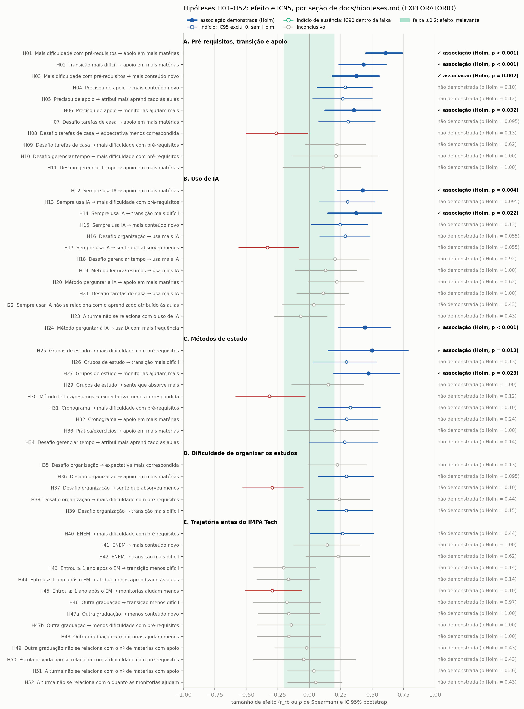

---

## A. Pré-requisitos, transição e apoio
1. Quem tem mais dificuldade com os pré-requisitos precisa de apoio em mais matérias. **[Holm]** Precisou de apoio × Q13: r_rb = +0,72. Q13 × Q14: ρ = 0,63.
2. Quem teve uma transição EM→superior mais difícil precisa de apoio em mais matérias. **[Holm]** Q11 × Q14: ρ = 0,41.
3. Quem tem mais dificuldade com os pré-requisitos vê mais conteúdo novo, possivelmente por defasagem no ensino anterior. **[Holm]** Q13 × Q24 (conteúdo novo): ρ = 0,38.
4. Quem precisou de apoio viu mais conteúdo novo. **[Indício]** r_rb = +0,33 [+0,07; +0,56].
5. Quem precisou de apoio atribui uma parte maior do seu aprendizado às aulas. **[Indício]** r_rb = +0,32 [+0,05; +0,56].
6. Quem precisou de apoio se beneficia mais das monitorias, porque é lá que recebe esse apoio. **[Indício]** r_rb = +0,44 [+0,20; +0,67].
7. Quem aponta as tarefas de casa como desafio precisa de apoio em mais matérias; as duas coisas podem refletir a mesma dificuldade. **[Indício]** r_rb = +0,43 [+0,19; +0,65].
8. Quem aponta as tarefas de casa como desafio tem as expectativas com a Matemática menos correspondidas. Uma possível explicação é a frustração com o curso, que o questionário não mede. **[Indício]** r_rb = −0,41 [−0,64; −0,16].
9. Quem aponta as tarefas de casa como desafio tem mais dificuldade com os pré-requisitos. **[Inconclusivo]** +0,24 [−0,02; +0,50].
10. Quem tem mais dificuldade com os pré-requisitos, por precisar correr atrás das matérias, tem mais dificuldade para gerenciar o tempo. **[Inconclusivo]** +0,33 [−0,01; +0,64]. A estimativa aponta na direção esperada.
11. Quem tem dificuldade para gerenciar o tempo precisa de apoio em mais matérias. **[Inconclusivo]** +0,18 [−0,15; +0,47].

## B. Uso de IA
12. Quem precisa de apoio em mais matérias usa IA com mais frequência, possivelmente para suprir essa dificuldade. **[Holm]** Sempre usa IA × Q14: r_rb = +0,46. Q14 × Q17: ρ = 0,42.
13. Quem tem mais dificuldade com os pré-requisitos usa IA com mais frequência para compensar. **[Indício]** +0,34 [+0,09; +0,57].
14. Quem teve uma transição mais difícil usa IA com mais frequência para compensar. **[Indício]** +0,34 [+0,10; +0,57].
15. Quem vê mais conteúdo novo usa IA com mais frequência. **[Indício]** +0,27 [+0,02; +0,51].
16. Quem tem dificuldade para organizar os estudos usa IA com mais frequência para suprir essa dificuldade. **[Indício]** +0,27 [+0,04; +0,49].
17. Quem sempre usa IA sente que absorveu menos o conteúdo. **[Indício no mapa]** −0,38 [−0,61; −0,12]. Na comparação direta entre "sempre usa IA" e "usa às vezes", o resultado **sobrevive a Holm** (−0,37, p Holm = 0,039).
    - A direção é ambígua: pode ser que usar IA reduza a absorção, ou que quem absorve menos recorra mais à IA.
18. Quem tem dificuldade para gerenciar o tempo usa mais IA. **[Inconclusivo]** +0,22 [−0,06; +0,49].
19. Quem estuda por leitura, anotação e resumos usa mais IA, possivelmente para ajudar nos resumos. **[Inconclusivo]** +0,27 [−0,01; +0,54]. O efeito é moderado, não forte.
20. Quem pergunta à IA como método de estudo precisa de apoio em mais matérias. **[Inconclusivo]** +0,22 [−0,02; +0,46].
21. Quem aponta as tarefas de casa como desafio usa mais IA para resolvê-las. **[Inconclusivo]** +0,15 [−0,08; +0,38].
22. Usar sempre IA está relacionado ao aprendizado atribuído às aulas. **[Inconclusivo]** −0,00 [−0,27; +0,26]. A estimativa é praticamente zero, mas o intervalo ainda permite efeitos de até ±0,27, então não dá para afirmar que não há relação.
23. A turma está relacionada ao uso de IA. **[Inconclusivo]** ρ = −0,12 [−0,34; +0,11].
24. Quem usa "perguntar a uma IA" como método usa IA com mais frequência. **[Indício]** +0,41 [+0,18; +0,61]. É quase redundante, porque as duas perguntas medem coisas muito próximas.

**Sempre usa IA × usa às vezes** (46 contra 31 pessoas; só 2 responderam "não"). Quem sempre usa:
- precisa de apoio em mais matérias: mediana 2 contra 0. **[Holm]**
- sente que absorveu menos: mediana 6 contra 7. **[Holm]**
- teve uma transição mais difícil: mediana 8 contra 7. **[Indício]**
- tem mais dificuldade com os pré-requisitos: mediana 7 contra 5. **[Indício]**
- marca mais "organização de estudos" como desafio: 74% contra 48%, p bruto = 0,03. **[Não sobrevive a Holm]**

Nas outras escalas, desafios e métodos, a diferença é inconclusiva.

## C. Métodos de estudo
25. Quem estuda em grupo tem mais dificuldade com os pré-requisitos. **[Indício]** +0,49 [+0,12; +0,79].
26. Quem estuda em grupo teve uma transição mais difícil, o que se relaciona com a hipótese 25. **[Indício]** +0,31 [+0,04; +0,56].
27. Quem estuda em grupo se beneficia mais das monitorias, que também funcionam como estudo em grupo. **[Indício]** +0,47 [+0,17; +0,73].
28. As aulas favorecem mais quem estuda por leitura, anotação e resumos do que quem estuda em grupo, já que ler, anotar e resumir é o que o aluno faz durante a aula.
    - **Leitura × aulas: [Indício]** +0,35 [+0,01; +0,65].
    - **Grupos × aulas: [Inconclusivo]** +0,33 [−0,01; +0,63].
    - As duas estimativas são quase iguais. Os dados **não** mostram diferença entre os dois grupos, e essa hipótese precisaria de um teste direto.
29. Quem estuda em grupo sente que absorve mais. **[Inconclusivo]** +0,16 [−0,15; +0,44].
    - A estimativa é positiva. O questionário não mede a eficiência dos grupos de estudo, então afirmar que eles são pouco eficientes não tem base nos dados.
30. Quem estuda por leitura, anotação e resumos tem as expectativas com a Matemática menos correspondidas (pouco relevante). **[Indício]** −0,33 [−0,64; −0,01].
31. Quem usa cronograma ou plano de estudos o usa para compensar a dificuldade com os pré-requisitos. **[Indício]** +0,37 [+0,05; +0,65].
32. Quem usa cronograma ou plano de estudos precisa de apoio em mais matérias. **[Inconclusivo]** +0,27 [−0,02; +0,55].
33. Quem estuda por prática, exercícios e listas precisa de apoio em mais matérias. **[Inconclusivo]** +0,30 [−0,08; +0,62]. Quase todos marcaram essa opção, então o grupo de comparação é muito pequeno.
34. Quem tem dificuldade para gerenciar o tempo, por não conseguir estudar antes da aula, atribui uma parte maior do aprendizado às aulas. **[Indício]** +0,36 [+0,07; +0,62].

## D. Dificuldade de organizar os estudos
A linha "Desafio: Organização de estudos" separa quem **marcou isso como desafio**, isto é, quem tem dificuldade para se organizar.

35. Quem tem dificuldade para organizar os estudos tem as expectativas com a Matemática **mais** correspondidas (pouco relevante). **[Indício]** +0,29 [+0,05; +0,53].
    - O sentido é o oposto do das tarefas de casa (hipótese 8): fica como pergunta por que esses dois desafios iriam em direções opostas.
36. Quem tem dificuldade para organizar os estudos precisa de apoio em mais matérias. **[Indício]** +0,28 [+0,04; +0,51].
    - A ideia de que a organização é usada para compensar dificuldades se aplica ao **cronograma** (hipótese 31), não aqui.
37. Quem tem dificuldade para organizar os estudos sente que absorveu menos, por não conseguir tempo para absorver tudo. **[Indício]** −0,30 [−0,54; −0,04].
38. Quem tem dificuldade para organizar os estudos tem mais dificuldade com os pré-requisitos. **[Inconclusivo]** +0,25 [−0,03; +0,50].
39. Quem teve uma transição mais difícil ficou mais desestabilizado para organizar os estudos. **[Inconclusivo]** +0,23 [−0,01; +0,48].

## E. Trajetória antes do IMPA Tech
40. Quem entrou pelo ENEM tem mais dificuldade com os pré-requisitos. **[Inconclusivo]** +0,28 [−0,06; +0,58].
    - A relação pode ficar mais clara separando quem entrou pelo ENEM mas também tem medalha.
    - **Limitação metodológica:** o questionário não perguntou se a pessoa tem medalha.
41. Quem entrou pelo ENEM viu mais conteúdo novo. **[Inconclusivo]** +0,24 [−0,07; +0,54]. Vale a mesma ressalva da hipótese 40.
42. Quem entrou pelo ENEM teve uma transição mais difícil. **[Inconclusivo]** +0,18 [−0,12; +0,47].
43. Quem entrou um ano ou mais depois do EM teve uma transição menos difícil, possivelmente pela experiência adquirida nesse tempo. **[Indício]** −0,29 [−0,53; −0,02].
44. Quem entrou um ano ou mais depois do EM atribui uma parte **menor** do aprendizado às aulas, possivelmente por ter mais conhecimento prévio. **[Indício]** −0,31 [−0,56; −0,05].
    - Vale verificar, dentro desse grupo, quem fez outra graduação e quem não fez.
45. Quem entrou um ano ou mais depois do EM se beneficia menos das monitorias. **[Indício]** −0,40 [−0,62; −0,15].
46. Quem iniciou outra graduação teve uma transição menos difícil. **[Inconclusivo]** −0,28 [−0,55; +0,02].
47. Quem iniciou outra graduação viu menos conteúdo novo e tem menos dificuldade com os pré-requisitos. **[Inconclusivo]** −0,14 e −0,20.
48. Quem iniciou outra graduação se beneficia menos das monitorias. **[Inconclusivo]** −0,25 [−0,50; +0,03].
49. Ter iniciado outra graduação está relacionado ao número de matérias em que precisou de apoio. **[Inconclusivo]** +0,02 [−0,26; +0,31].
    - A estimativa é quase zero, mas não dá para afirmar que não há relação.
50. O tipo de escola no ensino médio está relacionado à dificuldade. **[Inconclusivo]** Na dificuldade com pré-requisitos, por exemplo: +0,01 [−0,43; +0,45].
    - A análise só compara quem estudou em alguma escola privada com quem estudou só em escola pública.
    - Escola estadual e federal não foram separadas, e o intervalo é largo demais para concluir qualquer coisa.
51. A turma está relacionada ao número de matérias em que precisou de apoio. **[Inconclusivo]** ρ = 0,03 [−0,20; +0,24].
    - Os dados são compatíveis com nenhuma relação ou com uma relação pequena.
52. A turma está relacionada ao quanto as monitorias ajudam. **[Indício de ausência de relação]** ρ = 0,01 [−0,22; +0,23].
    - É o único caso em que os dados chegam perto de sustentar "não há relação", e ainda assim só como indício.

---

## Ao redigir
- Todas as relações acima são **associações**. Termos como "para suprir" ou "por causa de" descrevem a interpretação, não o que foi medido.
- Os itens [Indício] e [Inconclusivo] podem mudar quando a coleta terminar.
- Para os itens que vão virar hipóteses do modo final, registrar a direção esperada **antes** de rodar com o CSV completo.

---

## Como as hipóteses são testadas no notebook (seção 05a)
- **Amostra:** o estudo é exploratório; as hipóteses são testadas **com todas as respostas juntas**. Como foram formuladas olhando a prévia (respostas até 09/11/2026), os resultados descrevem esta amostra e não confirmam nada: as hipóteses ficam registradas para estudos futuros.
- **Direção:** cada hipótese é testada na direção escrita acima (teste unilateral). As hipóteses de "sem relação" (22, 23, 49, 50, 51 e 52) usam teste de equivalência: o efeito precisa ficar dentro de ±0,2.
- **Famílias (correção de Holm dentro de cada uma):**
  - **principal:** 1–8, 12–17, 24–27, 30, 31 e 34–37, 43–45;
  - **secundária:** 9–11, 18–21, 29, 32, 33, 38–42 e 46–48;
  - **ausência:** 22, 23 e 49–52.
- **Hipótese 47:** foi dividida em 47a (conteúdo novo) e 47b (pré-requisitos).
- **Hipótese 28:** não é testada como teste único, porque compara dois efeitos medidos nas mesmas pessoas.
- **Regra:** o texto das hipóteses não foi alterado depois da coleta completa.

---

# Hipóteses inspiradas na carta aberta dos estudantes (C01–C22)

Formuladas em 15/11/2026 a partir da *Carta aberta à comunidade do IMPA Tech* (estudantes, outubro de 2026). Quem as formulou já tinha visto a prévia. Como as H01–H52, são testadas com todas as respostas juntas, de forma exploratória. Todas são unilaterais, na direção indicada, e formam **uma família só** (`carta`, Holm). No notebook: seção 05i, lista `HIPOTESES_CARTA`.

Variáveis agregadas (seção 05h): **índice de dificuldade** = média dos postos de Q11, Q13 e Q14; **lacuna de absorção** = nota de "absorveu" menor que a de "conteúdo novo" (Q24); **permanência em risco** = reprovou/trancou (Q25) ou não pretende / não tem certeza se vai terminar (Q20).

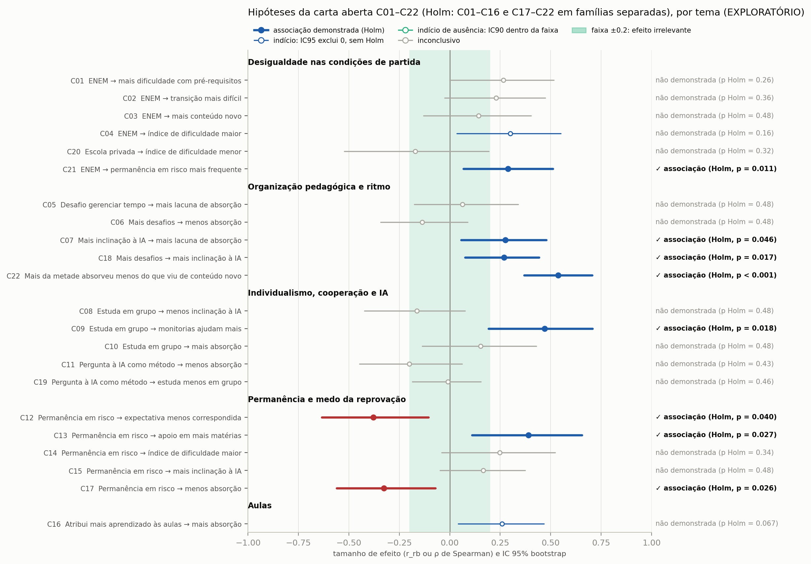

**Desigualdade nas condições de partida** (familiaridade desigual com conteúdos de olimpíada; proposta de pré-curso)
- C01. Quem entrou pelo ENEM tem mais dificuldade com os pré-requisitos. (+)
- C02. Quem entrou pelo ENEM teve uma transição mais difícil. (+)
- C03. Quem entrou pelo ENEM viu mais conteúdo novo. (+)
- C04. Quem entrou pelo ENEM tem índice de dificuldade maior. (+)

**Organização pedagógica e ritmo** (excesso de conteúdo em períodos curtos, acúmulo de listas e testes)
- C05. Quem marca "gerenciar tempo" como desafio tem mais lacuna de absorção. (+)
- C06. Quem marca mais desafios sente que absorveu menos. (−)
- C07. Mais inclinação ao uso de IA está associada a mais lacuna de absorção. (+)

**Individualismo, cooperação e IA** (IA como "principal companhia de estudo")
- C08. Quem estuda em grupo tem menos inclinação ao uso de IA. (−)
- C09. Quem estuda em grupo avalia melhor as monitorias. (+)
- C10. Quem estuda em grupo sente que absorveu mais. (+)
- C11. Quem usa "perguntar a uma IA" como método sente que absorveu menos. (−)

**Permanência e medo da reprovação**
- C12. Quem está com a permanência em risco tem a expectativa com a Matemática menos correspondida. (−)
- C13. Quem está com a permanência em risco precisou de apoio em mais matérias. (+)
- C14. Quem está com a permanência em risco tem índice de dificuldade maior. (+)
- C15. Quem está com a permanência em risco tem mais inclinação ao uso de IA. (+)

**Aulas**
- C16. Quem atribui mais o aprendizado às aulas sente que absorveu mais. (+)

**Sobreposições com hipóteses anteriores:** C01–C03 repetem a direção das hipóteses 40–42; C09 a da 27; C16 a da associação A1 da seção 11. C12 já tinha aparecido nas medianas do bloco B da seção 11. Na amostra total, essas hipóteses não são resultados novos.

## Segunda rodada (C17–C22)

Acrescentadas em 15/11/2026, **depois** das seções 05g–05i (contrastes, agregações, matriz de relações). Cobrem temas da carta que C01–C16 deixavam de fora. Ficam numa **família própria** (`carta-2`, Holm separado), para não mudar o ajuste de C01–C16. Também são testadas com todas as respostas juntas.

- C17. Quem está com a permanência em risco sente que absorveu menos. (−) *Carta: o medo da reprovação "prejudica o próprio aprendizado".*
- C18. Quem marca mais desafios tem mais inclinação ao uso de IA. (+) *Carta: listas extensas e prazos curtos associados à busca de respostas rápidas por IA.*
- C19. Quem usa "perguntar a uma IA" como método estuda menos em grupo. (−) *Carta: com pouca troca entre colegas, a IA vira a "principal companhia de estudo".* Desfecho 0/1: r_rb = diferença de proporções; o teste é mascarado se alguma célula tiver menos de 5 pessoas.
- C20. Quem estudou em escola privada tem índice de dificuldade menor. (−) *Carta: diferenças de trajetória e formação, inclusive as reconhecidas pelas cotas.* Atenção: a hipótese 50 trata escola × dificuldade como "sem relação"; C20 testa a direção contrária, na mesma amostra.
- C21. Quem entrou pelo ENEM está com a permanência em risco com mais frequência. (+) *Carta: desigualdade de partida e competição por notas desde o ingresso.* Desfecho 0/1, mesmo mascaramento da C19.
- C22. Mais da metade dos estudantes sente que absorveu menos do que viu de conteúdo novo (lacuna de absorção). (+) *Carta: "excesso de conteúdo em períodos curtos".* Teste binomial de uma amostra (H0: 50%); o efeito é 2p − 1 (proporção com lacuna menos proporção sem lacuna). Não é uma associação: no gráfico, "✓" significa só que a proporção é maior que 50% depois de Holm.

**Na prévia (N = 79):** C18 (ρ = +0,27, p Holm = 0,039) e C22 (77% com lacuna; 2p − 1 = +0,54, p Holm < 0,001) sobrevivem a Holm. C17 vai na direção prevista (r_rb = −0,29), mas o IC inclui zero. C19, C20 e C21 são inconclusivas. **Sobreposições:** C18 é próxima das hipóteses 18 e 21 (desafios isolados × IA); C17 já aparecia nas medianas do bloco B da seção 11; C22 é o teste do sinal da seção 05h, agora registrado como hipótese.

**Regra:** o texto destas hipóteses não foi alterado depois da coleta completa.

---

# Gráficos de apoio

Todos os gráficos de efeito com intervalo de confiança e faixa verde (±0,2, efeito irrelevante) estão na pasta `figuras/exploratorio/efeitos_ic_faixa/`. Em todos, as linhas são agrupadas pelos mesmos temas das seções A–E (mais F, permanência, e G, aulas e aprendizagem, para o que fica fora delas), e a coluna da direita diz se a associação foi demonstrada por Holm.

**Mapa de todas as associações grupo × escala (seção 05f)** — a base de onde saíram as hipóteses H01–H52.

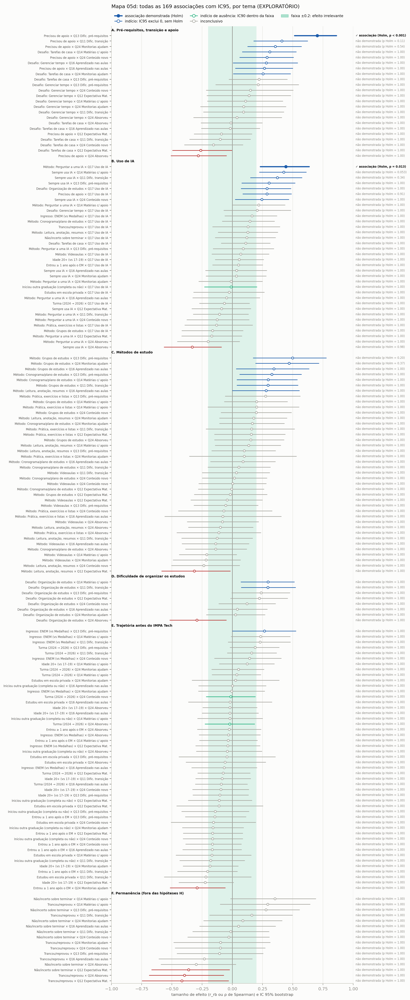

**Nível das relações entre 27 variáveis (seção 05i)** — matriz com o ρ de Spearman de todos os pares, rede só com as associações e os indícios, e os pares não inconclusivos com IC95.

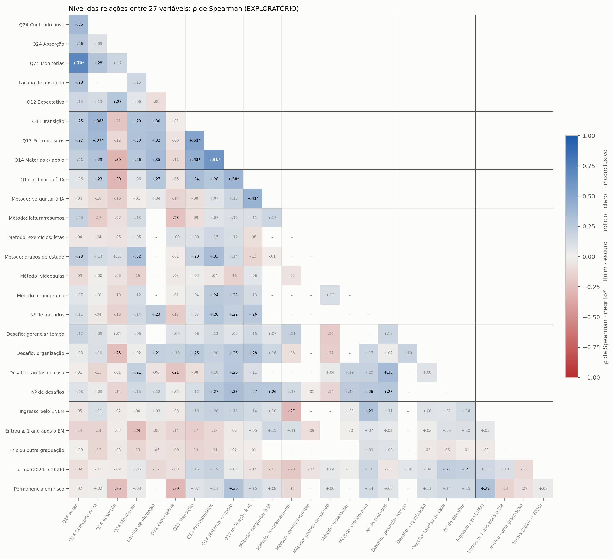

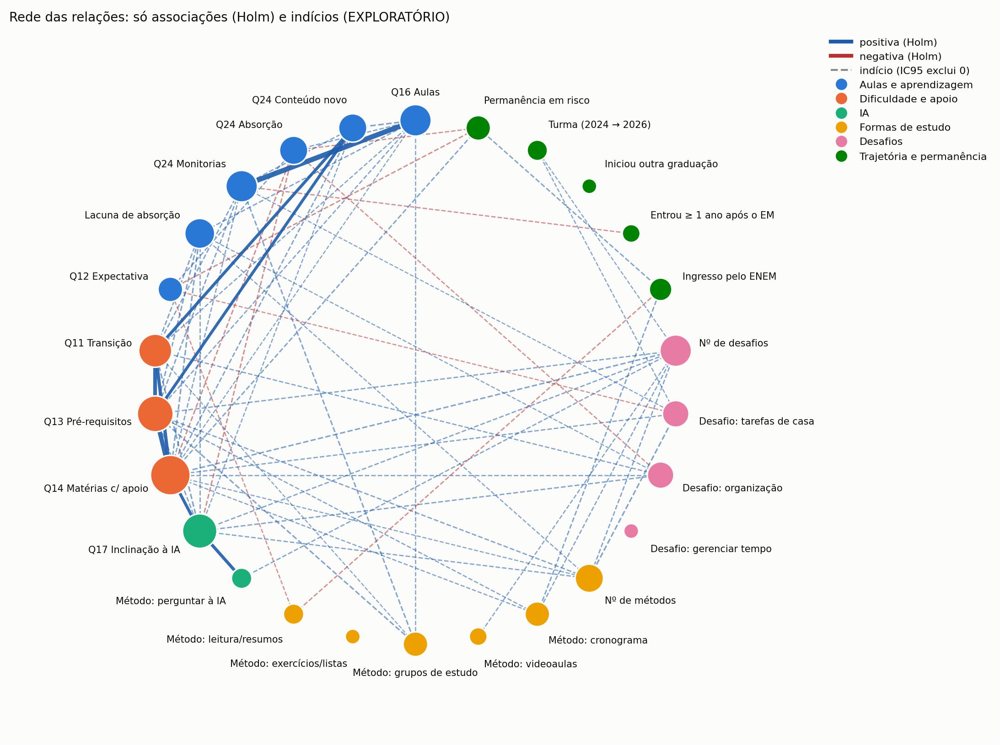

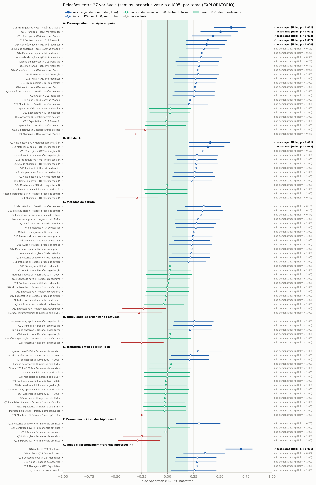

**Agregações (seção 05h)** — grupo "permanência em risco" × demais e índice de dificuldade (Q11 + Q13 + Q14).

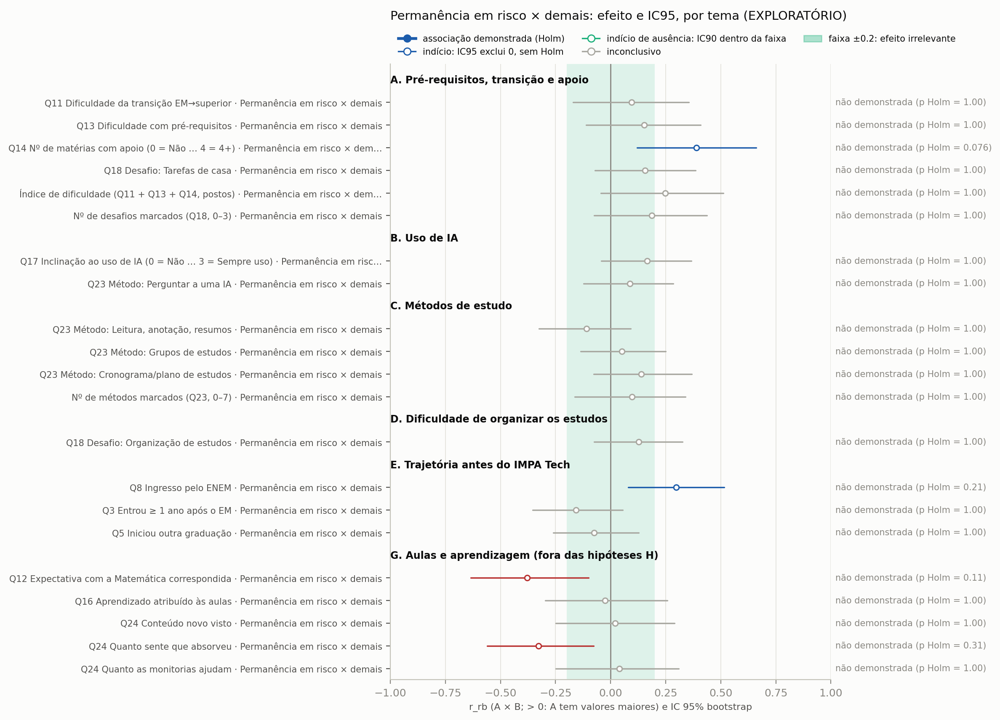

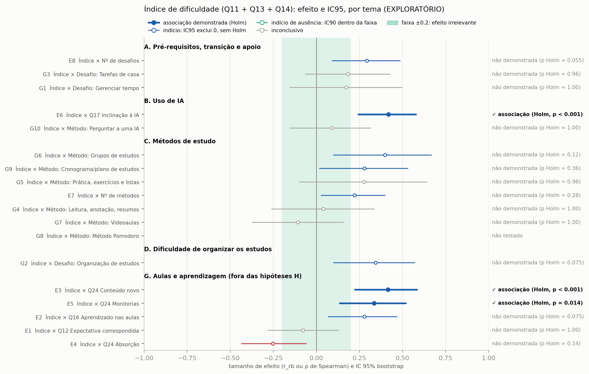

**Contrastes dois a dois (seção 05g)** — turmas, e tempo até o ingresso × outra graduação.

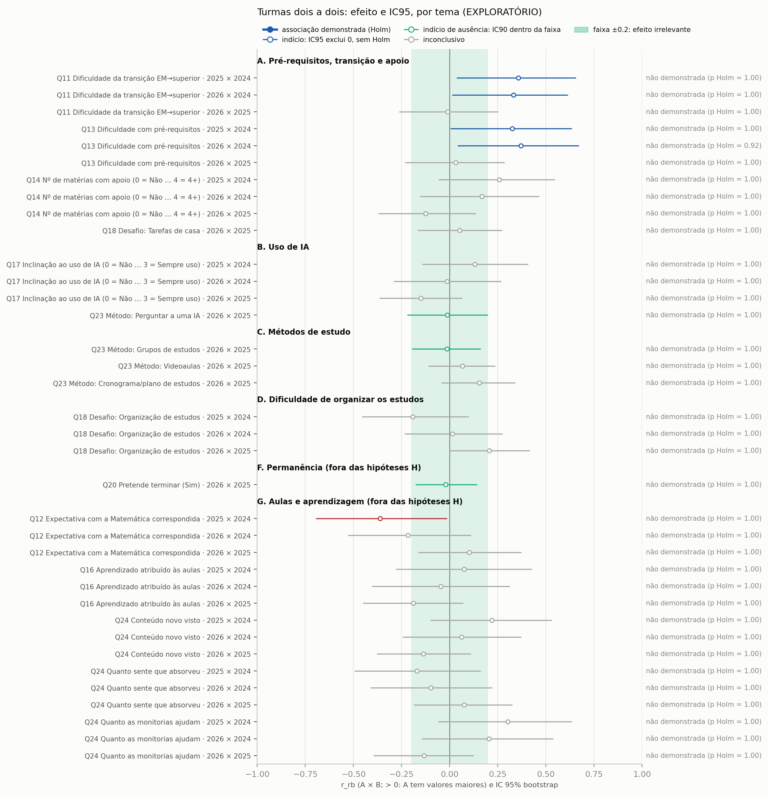

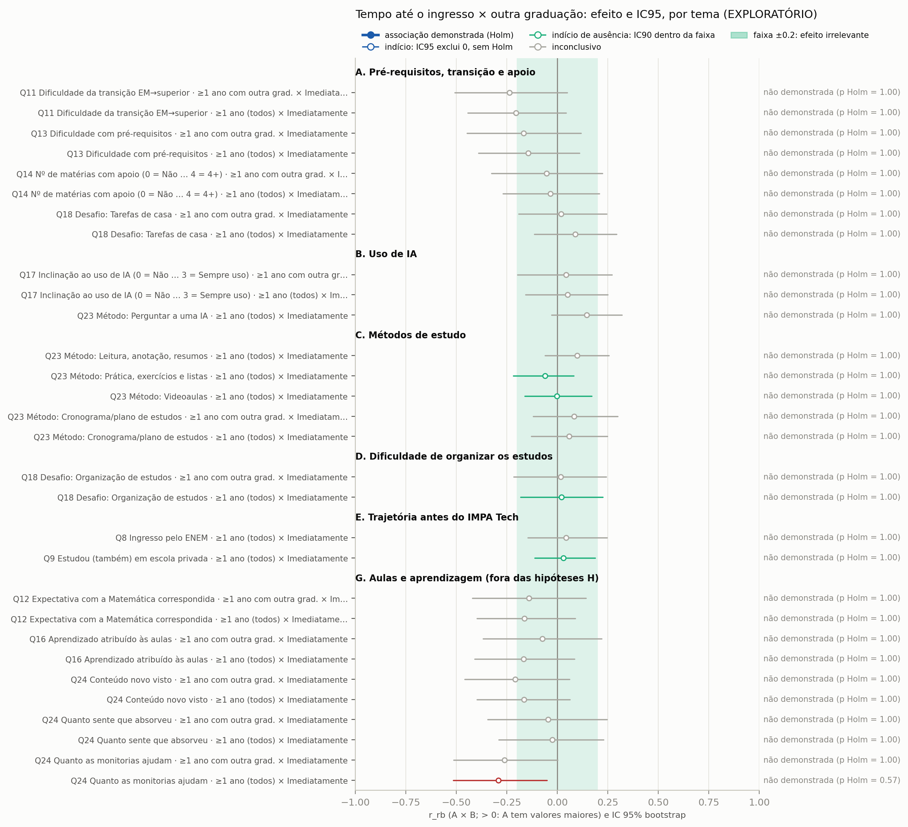

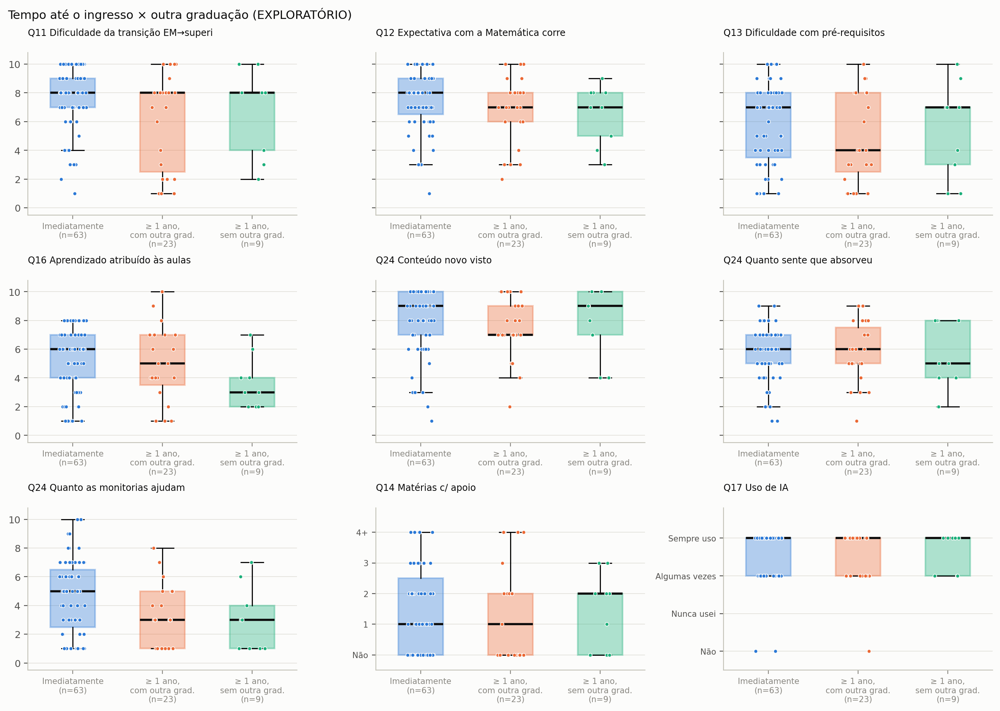

**Resumo expandido (seção 11)** — as 29 associações da família fixa, agrupadas pelos blocos A–D do roteiro do resumo.

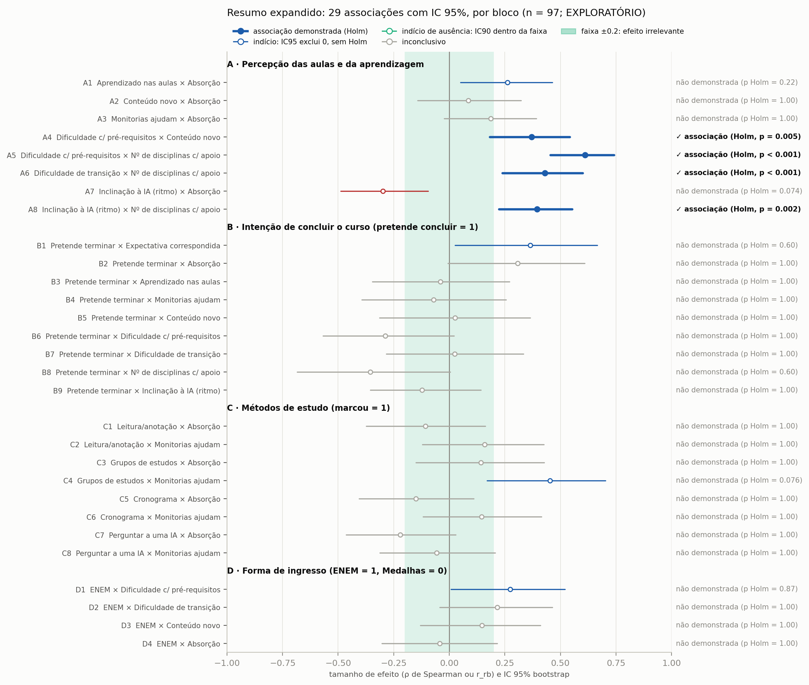

**Correlações entre as escalas (seção 06)**

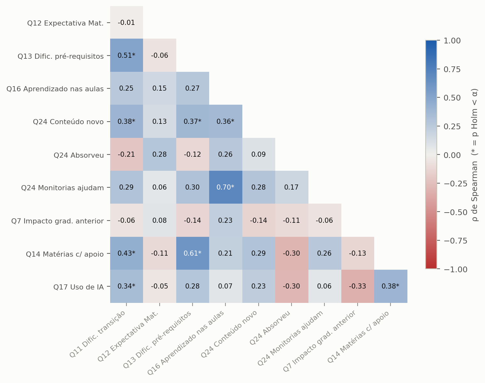
